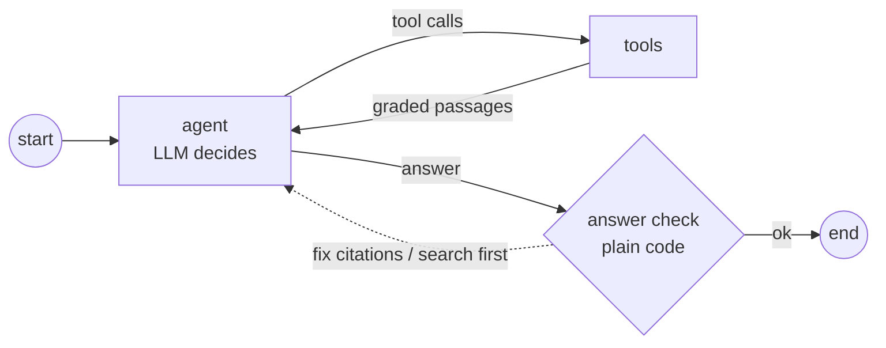

# Buyer Helpdesk Agent

A chat assistant for home buyers that answers from two sources: a (fictional) project's own
policies and the **Real Estate (Regulation and Development) Act, 2016**. It searches, checks
whether what it found actually answers the question, searches again if not, cites every answer,
and remembers each buyer across chats.

Week 2 of my public AI-agent portfolio. Week 1: [Clause Deviation Agent](https://github.com/Pallav6268/clause-deviation-agent).

> **Live demo:** https://buyer-helpdesk-agent.streamlit.app


## What you can ask

- "How do I get my money back if I cancel?"
- "Possession is late. What does RERA say I'm owed?"
- "What are the maintenance charges for my flat?" (uses the signed-in buyer's booking record)
- "Remember that I'm taking a home loan." (saved to that buyer's memory, visible in the sidebar)

## How it works



**Agentic RAG, step by step**

1. **Route.** The agent picks the source: project documents, the Act, or both.
2. **Hybrid search.** BM25 keywords plus `bge-small-en-v1.5` embeddings (via fastembed), fused
   with reciprocal rank fusion. Keywords catch "Section 18"; embeddings catch "get my money back" ≈ "refund".
3. **Grade.** A second LLM call keeps only the passages that help with the buyer's question.
   The rest are dropped and listed in the trace.
4. **Rewrite.** If nothing survives grading, the tool tells the agent to rewrite the query and
   search again (at most 3 searches per question).
5. **Answer with citations.** Every fact carries a passage ID such as `[payment_plan-3]` or
   `[rera-18-part1]`; the UI shows the cited passages under each answer.
6. **Answer check (plain code, not the LLM).** A citation to a passage no tool returned, an answer
   built on passages without citing them, or a factual answer given without searching is sent back
   with feedback, at most twice.
7. **Say "not found".** If the documents don't answer, the agent says so instead of guessing.

**Memory.** Facts the buyer states ("I'm adding my wife as co-buyer") are saved with the `remember`
tool to a small SQLite store and injected into the prompt on every turn. The sidebar shows everything
stored, with a delete button per fact and "Forget everything". The store refuses anything that looks
like a PAN, Aadhaar, card, account or phone number. On Streamlit Community Cloud the disk is
temporary, so memory lasts until the app restarts.

| Tool | Purpose |
|---|---|
| `search_documents(query, source)` | Hybrid search + LLM relevance grading; returns citable passages |
| `read_rera_section(section)` | Full text of one section of the Act |
| `get_my_booking()` | The signed-in buyer's booking record, cited as `[booking]` |
| `remember(fact)` | Save one lasting fact about the buyer |

## Knowledge base

| Source | Passages | Notes |
|---|---|---|
| RERA Act, 2016 | 137 (all 92 sections) | Official text from the [West Bengal RERA authority](https://rera.wb.gov.in/img/pdf/THE%20REAL%20ESTATE%20(REGULATION%20AND%20DEVELOPMENT)%20ACT,%202016.pdf), extracted by `scripts/extract_rera.py`; long sections are split at sub-section markers |
| Riverside Heights documents | 39 | **Fictional**: FAQ, payment plan, possession, cancellation and refund, maintenance, escalation |
| Booking records | 3 demo buyers | Fictional; same flats as Week 1's sample agreements |

## Run locally

```bash
python -m venv .venv
.venv/bin/pip install -r requirements.txt pytest        # Windows: .venv\Scripts\pip ...
.venv/bin/python -m pytest -q
.venv/bin/python -m streamlit run app.py
```

With no key the app runs in **demo mode**: a rule-based stand-in drives the same graph and quotes
the best passage. For the live agent, add one or more keys to `.streamlit/secrets.toml` (see
`.streamlit/secrets.toml.example`):

```toml
GEMINI_API_KEY = "..."   # free tier available; default model gemini-3.5-flash-lite
GROQ_API_KEY = "..."     # free tier; used automatically if Gemini fails
```

Order of use is Claude → Gemini → DeepSeek → Groq for whichever keys are set; `MODEL_ORDER`
(e.g. `gemini,groq`) changes it.

## Tests

`pytest` covers document loading and section splitting, the RERA extraction (all 92 sections),
keyword search, the LLM grader and its keyword fallback, query-rewrite prompting, the answer check
(invented citations, uncited answers, factual answers without search, the retry limit), memory
(dedupe, deletion, refusing identifiers, size cap) and provider fallback. No test calls a paid API.

## Limits

- Information only, not legal advice. State RERA rules (interest rates, timelines) are not included.
- The project, developer and buyers are fictional; the Act is real.

Built by [Pallav Kumar](https://www.linkedin.com/in/pallav-kumar-ai).
